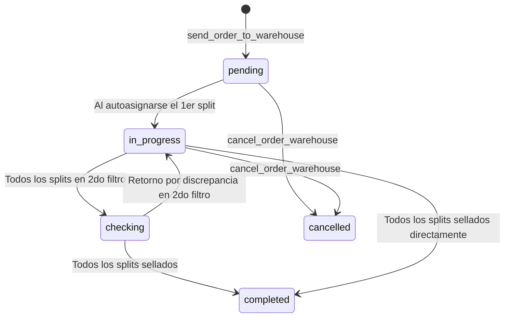
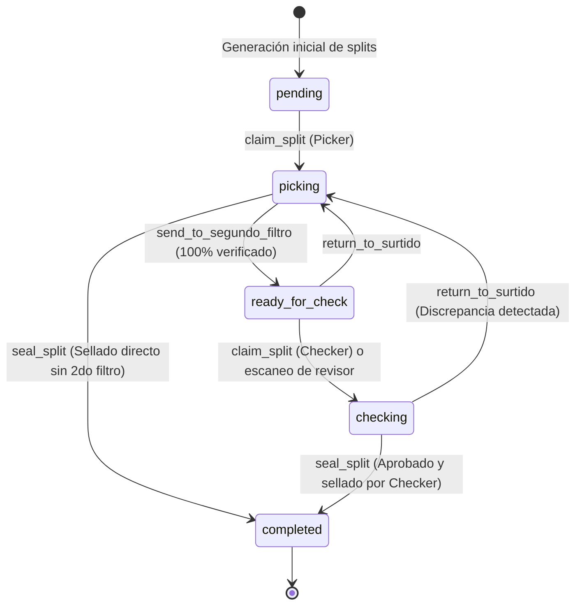
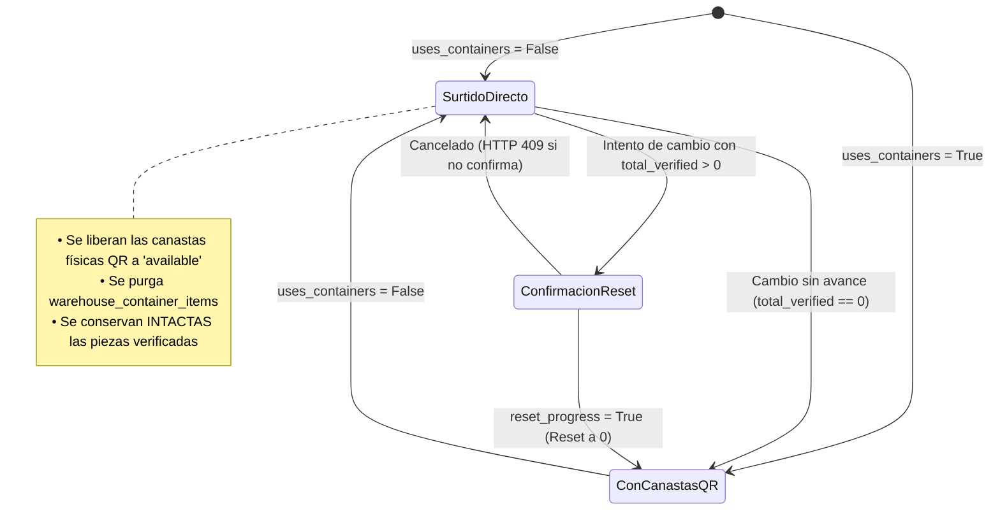

# 🏭 Especificación Técnica y Arquitectura Integral: Módulo de Bodega (WMS / Fulfillment)

> **Sistema:** Profarmed / Profarmed B2B E-Commerce & Warehouse Management System  
> **Área:** Bodega Central, Terminales Láser Hands-Free, 2do Filtro y Auditoría Forense  
> **Documento de Referencia RAG:** Consolidado O(1) de endpoints, schemas, CRUD, DB y máquinas de estados.

---

## 1. 🗺️ Visión General del Dominio y Arquitectura de Archivos

El sistema de almacén opera bajo una arquitectura desacoplada y modular. Todas las dependencias CRUD se exponen a través de un façade unificado en [`backend/profarmed_api/crud/crud_warehouse.py`](file:///c:/Users/berna/Documents/GitProjects/profarmed-ecommerce/backend/profarmed_api/crud/crud_warehouse.py) y se subdividen en submódulos especializados:

```
backend/profarmed_api/
├── db/
│   └── base.py                     # Modelos ORM: Order, WarehouseSplit, WarehouseItem, WarehouseContainer, WarehouseContainerItem
├── schemas/
│   └── warehouse.py                # Contratos de datos Pydantic v2 (Requests & Responses)
├── routes/warehouse/
│   ├── __init__.py                 # Router maestro montado en /warehouse
│   ├── queue.py                    # Cola FIFO, auto-asignación (Claims) y operadores
│   ├── operations.py               # Operatoria láser (+1 scan), empaque por cajas y manual
│   ├── splits.py                   # Transiciones de split, sellos, modalidades y fast-track
│   ├── containers.py               # Trazabilidad de canastas físicas QR (Totes)
│   ├── dispatch.py                 # Enrutamiento de pedidos, partición de splits y visibilidad
│   └── audit.py                    # Reporte pericial forense, bitácora de eventos y overrides admin
└── crud/
    ├── crud_warehouse.py           # Façade consolidado de re-exportación
    ├── crud_warehouse_scanning.py  # Algoritmos de lectura láser, cajas cerradas y validación manual
    ├── crud_warehouse_splits.py    # Máquina de estados de split, modalidad (directo vs canastas) y sellos
    ├── crud_warehouse_containers.py# Asignación, liberación y agregación de canastas QR
    ├── crud_warehouse_audit.py     # Auditoría forense ultra-optimizada con selectinload
    ├── crud_warehouse_queue.py     # Paginación lookahead de cola FIFO y reasignaciones
    └── crud_warehouse_status.py    # Recálculo atómico de estatus a nivel Split y Pedido
```

---

## 2. 🔄 Diagrama de Máquinas de Estados y Transiciones

### 2.1 Estatus del Pedido en Bodega (`orders.warehouse_status`)



### 2.2 Estatus de los Lotes de Surtido (`warehouse_splits.status`)



### 2.3 Modalidad de Recolección en Piso (`uses_containers`)



---

## 3. 🗄️ Esquema de Base de Datos y Objetos Manipulados

### 3.1 `orders` (Fragmento relevante de Bodega)
| Columna | Tipo | Descripción |
| :--- | :--- | :--- |
| `order_id` | `BigInteger (PK)` | Identificador secuencial del pedido |
| `sent_to_warehouse` | `Boolean` | Flag booleano de activación en bodega |
| `warehouse_status` | `String(30)` | `pending`, `in_progress`, `checking`, `completed`, `cancelled` |
| `warehouse_show_details`| `Boolean` | `False` = Surtido Ciego (ciego hasta claim) \| `True` = Detallado |
| `total_splits` | `Integer` | Cantidad total de particiones asignadas (default: 1) |
| `warehouse_sent_at` | `TIMESTAMP(TZ)` | Fecha y hora en que se envió a la cola de surtido |
| `warehouse_sent_by` | `Integer (FK)` | Usuario administrador o ventas que despachó a bodega |

### 3.2 `warehouse_splits` (Lotes concurrentes de surtido)
| Columna | Tipo | Restricción | Descripción |
| :--- | :--- | :--- | :--- |
| `split_id` | `UUID (PK)` | `uuid_generate_v4()` | Identificador universal del lote físico |
| `order_id` | `BigInteger (FK)` | `ON DELETE CASCADE` | Pedido al que pertenece |
| `split_number` | `Integer` | `UNIQUE(order_id, split_number)` | Número de partición (1, 2, ... N) |
| `split_code` | `String(50)` | Indexado | Código legible de lote (ej: `105-1`) |
| `status` | `String(30)` | Indexado | `pending`, `picking`, `ready_for_check`, `checking`, `completed`, `cancelled` |
| `picker_id` | `Integer (FK)` | `users.user_id` | Recolector de piso asignado |
| `checker_id` | `Integer (FK)` | `users.user_id` | Revisor de calidad en 2do filtro asignado |
| `uses_containers` | `Boolean` | Default: `False` | Modalidad estricta con canastas QR vs surtido directo |
| `active_container_id` | `UUID (FK)`| `warehouse_containers` | Canasta activa hacia donde viajan los escaneos |
| `security_seal_folio`| `String(50)`| Nullable | Folio o precinto de seguridad sellado |
| `started_at` | `TIMESTAMP(TZ)`| Nullable | Timestamp del primer claim o escaneo de surtido |
| `picking_completed_at`| `TIMESTAMP(TZ)`| Nullable | Fin del 1er filtro de recolección |
| `checking_started_at`| `TIMESTAMP(TZ)`| Nullable | Inicio de la auditoría en 2do filtro |
| `completed_at` | `TIMESTAMP(TZ)`| Nullable | Fecha y hora de sellado final |
| `admin_override_by` | `Integer (FK)` | Nullable | Usuario que forzó rectificación administrativa |

### 3.3 `warehouse_items` (Partidas físicas por Split)
| Columna | Tipo | Descripción |
| :--- | :--- | :--- |
| `warehouse_item_id` | `UUID (PK)` | Identificador único de partida |
| `split_id` | `UUID (FK)` | Split asignado |
| `order_item_id` | `UUID (FK)` | Partida del pedido original (`orderitems`) |
| `product_id` | `String(50) (FK)` | SKU del producto |
| `container_id` | `UUID (FK)` | Canasta actual asignada (nullable en surtido directo) |
| `required_quantity`| `Integer` | Cantidad requerida de piezas en esta partición |
| **1er Filtro (Picker)** | | |
| `picked_scanned_qty`| `Integer` | Unidades pistoleadas con lector láser |
| `picked_boxes` | `Integer` | Cajas maestras de fábrica ingresadas |
| `picked_box_prods` | `Integer` | Unidades totales equivalentes de las cajas |
| `picked_manual_qty` | `Integer` | Unidades capturadas manualmente |
| `picked_manual_reason`| `String(255)` | Justificación pericial de captura manual |
| `picked_total_qty` | `Computed Column`| `scanned + box_prods + manual` |
| `picked_by` / `picked_at`| User / Timestamp | Operador y marca de tiempo del surtido |
| **2do Filtro (Checker)** | | |
| `checked_scanned_qty`| `Integer` | Unidades pistoleadas por el revisor |
| `checked_boxes` | `Integer` | Cajas maestras revisadas |
| `checked_box_prods`| `Integer` | Unidades equivalentes de cajas en revisión |
| `checked_manual_qty`| `Integer` | Unidades revisadas manualmente o validadas por confianza |
| `checked_manual_reason`| `String(255)` | Motivo de revisión o 'Confianza en Surtido' |
| `checked_total_qty` | `Computed Column`| `checked_scanned + checked_box_prods + checked_manual` |
| `checked_by` / `checked_at`| User / Timestamp| Revisor y marca de tiempo de calidad |
| **Auditoría & Status** | | |
| `status` | `String(20)` | `pending`, `partial`, `completed`, `discrepancy` |
| `admin_override_by` | `Integer (FK)` | Auditor/Admin que rectificó conteos |

### 3.4 `warehouse_containers` & `warehouse_container_items` (Trazabilidad QR de Canastas)
- **`warehouse_containers`:** Registra cada contenedor físico reutilizable (`qr_code`, `status`: `available`, `in_use`, `maintenance`, `current_split_id`, `current_user_id`).
- **`warehouse_container_items`:** Tabla de desagregación física que almacena qué piezas específicas y por qué método entraron a qué canasta concreta.

---

## 4. 🛡️ Catálogo de Rutas, PBAC y Schemas Pydantic

### 4.1 Sub-Router: Despacho y Ciclo de Vida (`/warehouse/orders/...`)

| Endpoint | Verbo HTTP | Permiso PBAC Requerido | Schema Request Body | Schema Response Body | Propósito Funcional |
| :--- | :---: | :--- | :--- | :--- | :--- |
| `/orders/{order_id}/send-to-warehouse` | `POST` | `warehouse.send`, `warehouse.supervisor`, `warehouse.manage`, `system.admin` | `WarehouseSendToWarehouseRequest` | `WarehouseAuditOrderResponse` | Activa pedido en bodega, divide en N splits y define modo ciego o detallado. |
| `/orders/{order_id}/visibility` | `PATCH` | `warehouse.supervisor`, `warehouse.manage`, `system.admin` | `WarehouseToggleDetailsRequest` | `WarehouseAuditOrderResponse` | Conmuta visibilidad entre Surtido Ciego (`False`) y Detallado (`True`). |
| `/orders/{order_id}/cancel-warehouse` | `POST` | `orders.cancel`, `warehouse.manage`, `system.admin` | Ninguno | `{"success": True, "message": "..."}` | Cancela proceso de bodega, resetea splits y libera canastas asociadas. |

#### Schemas Pydantic Involucrados:
```python
class WarehouseSendToWarehouseRequest(BaseModel):
    total_splits: int = Field(default=1, ge=1, le=20)
    show_details: bool = Field(default=False)

class WarehouseToggleDetailsRequest(BaseModel):
    show_details: bool = Field(...)
```

---

### 4.2 Sub-Router: Cola FIFO y Asignaciones (`/warehouse/...`)

| Endpoint | Verbo HTTP | Permiso PBAC Requerido | Parámetros Query / Body | Schema Response Body | Propósito Funcional |
| :--- | :---: | :--- | :--- | :--- | :--- |
| `/queue/fifo` | `GET` | `warehouse.view`, `warehouse.operator`, `warehouse.checker`, `warehouse.manage`, `system.admin` | `skip`, `limit`, `status`, `search` | `WarehouseFifoQueueResponse` | Lista splits listos para ser tomados ordenados por prioridad FIFO. |
| `/splits/{split_id}/claim` | `POST` | `warehouse.operator`, `warehouse.checker`, `warehouse.manage`, `system.admin` | `WarehouseClaimSplitRequest` | `WarehouseSplitResponse` | Auto-asignación de un split como Picker o Checker con selección de modalidad. |
| `/operators` | `GET` | `warehouse.manage`, `users.view`, `system.admin` | `skip`, `limit`, `search` | `List[UserMinimalResponse]` | Catálogo de almacenistas para reasignaciones manuales. |
| `/splits/{split_id}/reassign` | `POST` | `warehouse.manage`, `system.admin` | `WarehouseReassignSplitRequest` | `WarehouseSplitResponse` | Reasigna formalmente a otro picker o checker sin perder avance físico. |

#### Schemas Pydantic Involucrados:
```python
class WarehouseClaimSplitRequest(BaseModel):
    role_type: str = Field(default="picker", pattern="^(picker|checker)$")
    uses_containers: Optional[bool] = Field(default=None)

class WarehouseReassignSplitRequest(BaseModel):
    target_user_id: int = Field(...)
    role_type: str = Field(default="picker", pattern="^(picker|checker)$")
```

---

### 4.3 Sub-Router: Operatoria de Escaneo Láser (`/warehouse/splits/{id}/...`)

| Endpoint | Verbo HTTP | Permiso PBAC Requerido | Schema Request Body | Schema Response Body | Propósito Funcional |
| :--- | :---: | :--- | :--- | :--- | :--- |
| `/splits/{split_id}/scan-barcode` | `POST` | `warehouse.operator`, `warehouse.checker`, `warehouse.manage`, `system.admin` | `WarehouseScanBarcodeRequest` | `WarehouseScanResultResponse` | Disparo +1 de pistola láser (código de barras de producto o QR de canasta). |
| `/splits/{split_id}/add-boxes` | `POST` | `warehouse.operator`, `warehouse.checker`, `warehouse.manage`, `system.admin` | `WarehouseAddBoxesRequest` | `WarehouseSplitResponse` | Ingreso rápido de producto en cajas maestras de empaque cerrado. |
| `/splits/{split_id}/manual-verification` | `POST` | `warehouse.operator`, `warehouse.checker`, `warehouse.manage`, `system.admin` | `WarehouseManualVerificationRequest`| `WarehouseSplitResponse` | Registro manual de piezas por código roto o daño con justificación pericial. |

#### Schemas Pydantic Involucrados:
```python
class WarehouseScanBarcodeRequest(BaseModel):
    barcode: str = Field(..., min_length=1)

class WarehouseAddBoxesRequest(BaseModel):
    order_item_id: UUID = Field(...)
    boxes_count: int = Field(..., ge=1)
    units_per_box: int = Field(..., ge=1)

class WarehouseManualVerificationRequest(BaseModel):
    order_item_id: UUID = Field(...)
    quantity: int = Field(..., ge=1)
    reason: str = Field(..., min_length=3, max_length=255)
```

---

### 4.4 Sub-Router: Modalidad, Transiciones y Sellado (`/warehouse/splits/{id}/...`)

| Endpoint | Verbo HTTP | Permiso PBAC Requerido | Schema Request Body | Schema Response Body | Propósito Funcional |
| :--- | :---: | :--- | :--- | :--- | :--- |
| `/splits/{split_id}/set-container-mode`| `POST` | `warehouse.operator`, `warehouse.checker`, `warehouse.manage`, `system.admin` | `WarehouseSetContainerModeRequest` | `WarehouseSplitResponse` | Conmuta modalidad. Si cambia a Canastas con avance previo sin `reset_progress=True`, rechaza con **HTTP 409 Conflict**. |
| `/splits/{split_id}/send-to-segundo-filtro`| `POST` | `warehouse.operator`, `warehouse.supervisor`, `warehouse.manage`, `system.admin` | Ninguno | `WarehouseSplitResponse` | Transfiere lote del 1er filtro a mesa de revisión (`ready_for_check`). |
| `/splits/{split_id}/return-to-surtido`| `POST` | `warehouse.checker`, `warehouse.supervisor`, `warehouse.manage`, `system.admin` | Ninguno | `WarehouseSplitResponse` | Devuelve split de revisión a surtido por discrepancia física o faltante. |
| `/splits/{split_id}/checker-fast-track`| `POST` | `warehouse.checker`, `warehouse.supervisor`, `warehouse.manage`, `system.admin` | Ninguno | `WarehouseSplitResponse` | Valida 100% de revisión por confianza basada en el trabajo del Picker. |
| `/splits/{split_id}/seal` | `POST` | `warehouse.operator`, `warehouse.checker`, `warehouse.manage`, `system.admin` | `WarehouseSealSplitRequest` | `WarehouseSplitResponse` | Sella el lote aplicando folio/cincho de seguridad y finaliza el split. |

#### Schemas Pydantic Involucrados:
```python
class WarehouseSetContainerModeRequest(BaseModel):
    uses_containers: bool = Field(..., description="True para Canastas QR, False para Surtido Directo")
    reset_progress: bool = Field(default=False, description="Debe ser True si ya existen piezas y se desea reiniciar a 0")

class WarehouseSealSplitRequest(BaseModel):
    security_seal_folio: Optional[str] = Field(None, max_length=50)
```

---

### 4.5 Sub-Router: Trazabilidad de Canastas Físicas QR (`/warehouse/containers/...`)

| Endpoint | Verbo HTTP | Permiso PBAC Requerido | Schema Request Body | Schema Response Body | Propósito Funcional |
| :--- | :---: | :--- | :--- | :--- | :--- |
| `/containers` | `GET` | `warehouse.view`, `warehouse.manage`, `system.admin` | `status`, `skip`, `limit` | `List[WarehouseContainerResponse]` | Catálogo de canastas físicas registradas en el almacén. |
| `/containers` | `POST` | `warehouse.manage`, `system.admin` | `WarehouseContainerCreate` | `WarehouseContainerResponse` | Alta de nuevo contenedor físico con su etiqueta QR. |
| `/containers/bind-to-split` | `POST` | `warehouse.operator`, `warehouse.checker`, `warehouse.manage`, `system.admin` | `WarehouseBindContainerRequest` | `WarehouseContainerResponse` | Vincula un tote físico QR a un split activo. |
| `/containers/release` | `POST` | `warehouse.operator`, `warehouse.checker`, `warehouse.manage`, `system.admin` | `WarehouseReleaseContainerRequest`| `WarehouseContainerResponse` | Desvincula una canasta individual y la libera a `available`. |
| `/containers/release-all` | `POST` | `warehouse.operator`, `warehouse.checker`, `warehouse.manage`, `system.admin` | `WarehouseReleaseAllContainersRequest`| `{"success": True, "released_count": N}` | Libera en bloque todas las canastas del split. |

---

### 4.6 Sub-Router: Auditoría Forense y Rectificaciones Admin (`/warehouse/...`)

| Endpoint | Verbo HTTP | Permiso PBAC Requerido | Schema Request Body | Schema Response Body | Propósito Funcional |
| :--- | :---: | :--- | :--- | :--- | :--- |
| `/orders/{order_id}/audit-breakdown` | `GET` | `warehouse.audit`, `warehouse.view`, `system.admin` | `skip`, `limit` | `WarehouseAuditOrderResponse` | Reporte forense pericial ultra-optimizado pieza por pieza con dictamen de discrepancias. |
| `/splits/{split_id}/events` | `GET` | `warehouse.audit`, `warehouse.events`, `system.admin` | Ninguno | `List[WarehouseContainerItemResponse]`| Bitácora atómica de escaneos y auditoría forense (Event Ledger). |
| `/splits/{split_id}/admin-override` | `PATCH` | `warehouse.manage`, `system.admin` | `WarehouseAdminSplitOverrideRequest`| `WarehouseSplitResponse` | Forzado administrativo de estatus o retiro/rectificación de precintos. |
| `/order-items/{id}/admin-override-counts`| `PATCH` | `warehouse.manage`, `system.admin` | `WarehouseAdminItemCountsOverrideRequest`| `WarehouseSplitItemResponse`| Rectificación pericial de conteos físicos en 1er o 2do filtro. |
| `/stats` | `GET` | `warehouse.view`, `reports.view`, `system.admin` | Ninguno | `WarehouseStatsResponse` | KPIs de bodega en tiempo real (turnos, órdenes activas, completadas). |

---

## 5. ⚙️ Detalle de Implementación: Funciones CRUD Clave

### 5.1 Escaneo Inteligente (`scan_barcode`)
Ubicación: [`backend/profarmed_api/crud/crud_warehouse_scanning.py`](file:///c:/Users/berna/Documents/GitProjects/profarmed-ecommerce/backend/profarmed_api/crud/crud_warehouse_scanning.py)
- **Detección Automática de Código:** Si el código escaneado coincide con una canasta registrada en el sistema o asociada al split, la activa automáticamente como `active_container_id` sin registrar piezas.
- **Validación de Modalidad:**
  - Si `split.uses_containers == True`: Exige que `split.active_container_id` exista. Si no hay canasta activa, rechaza con HTTP 400 (`🧺 Modo Canastas activo: Debes escanear o vincular primero el código QR de una canasta`).
  - Si `split.uses_containers == False`: Registra directamente en `warehouse_items`. Si casualmente hay una canasta vinculada, opcionalmente guarda el `container_id`, pero nunca bloquea la recolección.
- **Aislamiento por Rol:** Evalúa si el usuario es `picker` o `checker` para incrementar atómicamente `picked_scanned_qty` o `checked_scanned_qty`.

### 5.2 Alternancia Estricta de Modalidad (`set_split_container_mode`)
Ubicación: [`backend/profarmed_api/crud/crud_warehouse_splits.py`](file:///c:/Users/berna/Documents/GitProjects/profarmed-ecommerce/backend/profarmed_api/crud/crud_warehouse_splits.py)
- **Directo ➔ Canastas QR:**
  - Calcula `total_picked_units = SUM(picked_scanned_qty + picked_box_prods + picked_manual_qty)`.
  - Si `total_picked_units > 0` y `reset_progress == False`: Lanza `HTTP 409 Conflict` con payload `{ "require_reset_confirmation": True, "picked_units": X }`.
  - Si `reset_progress == True`: Restablece a 0 todos los contadores de recolección en `warehouse_items` del split, purga `warehouse_container_items` y activa `uses_containers = True`.
- **Canastas QR ➔ Directo:**
  - Purga `warehouse_container_items` del split.
  - Setea `container_id = NULL` en `warehouse_items`.
  - Libera todas las canastas vinculadas devolviéndolas a estatus `available`.
  - **Mantiene intactos al 100% los avances verificados en `warehouse_items`.**

### 5.3 Auditoría Forense Libre de Bloqueos (`get_order_warehouse_audit`)
Ubicación: [`backend/profarmed_api/crud/crud_warehouse_audit.py`](file:///c:/Users/berna/Documents/GitProjects/profarmed-ecommerce/backend/profarmed_api/crud/crud_warehouse_audit.py)
- **Cero Explosión Cartesiana:** Emplea `selectinload` para colecciones hijas (`Order.items`, `Order.splits`, `WarehouseSplit.containers`, `WarehouseSplit.container_items`), ejecutando 6 consultas indexadas independientes en lugar de un `joinedload` masivo.
- **Agregación en Memoria:** Calcula el desglose pericial por canasta física (`containers_summary`) directamente desde los objetos en memoria en $O(N)$, eliminando subconsultas SQL adicionales en bucle.
- **Dictamen Pericial de Discrepancias:** Compara partida por partida el conteo del Picker vs Checker (`has_forensic_discrepancy`), desglosando diferencias de cajas, láser y manuales para auditores y administradores.

---

## 6. 💻 Capa Frontend: Servicios y Componentes

### 6.1 Servicio Frontend ([`react/src/services/warehouseService.js`](file:///c:/Users/berna/Documents/GitProjects/profarmed-ecommerce/react/src/services/warehouseService.js))
Encapsula todas las peticiones Axios hacia `/warehouse`:
- `getFifoQueue(params)`
- `claimSplit(splitId, roleType, usesContainers)`
- `scanBarcode(splitId, barcode)`
- `addBoxes(splitId, orderItemId, boxesCount, unitsPerBox)`
- `manualVerification(splitId, orderItemId, quantity, reason)`
- `setContainerMode(splitId, usesContainers, resetProgress = false)`
- `bindContainerToSplit(splitId, qrCode)`
- `releaseContainer({ container_id, split_id, qr_code })`
- `checkerFastTrack(splitId)`
- `sealSplit(splitId, sealFolio)`
- `getAuditBreakdown(orderId, params)`

### 6.2 Componentes UI Principales
- **`WarehouseLaserStation.jsx`:** Estación láser para operarios y revisores. Incluye HUD interactivo, selector táctil de canasta activa, barra dedicada de modalidad (`warehouse-terminal__mode-strip`), modal de advertencia de reseteo ante 409 Conflict y soporte táctil sin teclado para dispositivos móviles.
- **`ModalWarehouseAudit.jsx`:** Ventana modal de auditoría pericial con banners forenses, desglose por canastas QR físicas y tabla comparativa Surtidor vs Revisor con protección contra peticiones concurrentes (`loadingRef`).
- **`ModalWarehouseEventsLedger.jsx`:** Bitácora forense atómica con pestañas de "Resumen por Canasta" y "Detalle por Producto" utilizando el diseño BEM unificado de almacén.
- **`WarehouseAdminSection.jsx`:** Panel general de supervisión de pedidos, colas y partición en splits.
