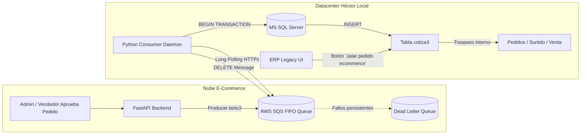
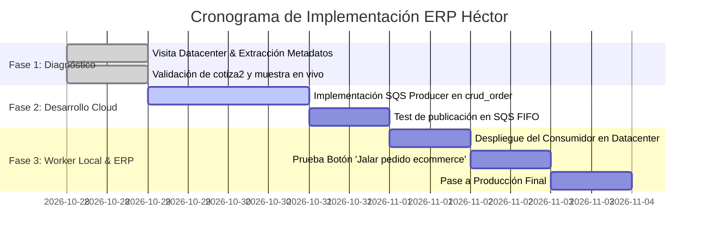

# 📋 Especificación de Integración ERP Héctor: Buffer `cotiza3` & AWS SQS FIFO

> **Fecha:** 25 de Octubre de 2026  
> **Estado:** Propuesta Técnica & Guía de Campo (Listo para ejecución en Datacenter)  
> **Autor:** Bernardo Orozco & Antigravity Agent  
> **Destino:** Servidor On-Premise Datacenter (Héctor) / Microsoft SQL Server  
> **Interlocutor ERP:** Ing. Jaime (Desarrollador / Mantenedor del ERP Legacy)  

---

## 1. 📌 Contexto y Diagnóstico de la Situación

### 1.1 Antecedentes
El cliente Héctor opera con un sistema ERP legacy desarrollado para entornos de mostrador, mayoreo y farmacia, sustentado sobre un motor de base de datos **Microsoft SQL Server** instalado en su propio Datacenter local.

Actualmente, el ERP cuenta con un flujo de captura remota mediante una tabla de paso intermedia denominada **`cotiza2`**, donde una aplicación móvil previa deposita pedidos en estado de preventa / cotización. El personal de bodega y ventas en mostrador utiliza una función nativa en la UI del ERP denominada:
> **"Jalar pedido app"** $\rightarrow$ Extrae los registros de `cotiza2`, crea un pedido interno transaccional, el personal de bodega lo surte físicamente, realiza ajustes de partidas si faltara existencia, y finalmente el cajero/facturador timbra la venta final.

### 1.2 Estrategia Acordada con el Ing. Jaime
En coordinación directa con Jaime (desarrollador del ERP):
1. **Creación de `cotiza3`:** Se creó la tabla `cotiza3`, idéntica en estructura DDL a `cotiza2`, con el objetivo de **aislar el tráfico del nuevo E-Commerce** respecto a la app legacy existente.
2. **Nuevo Botón en ERP:** Jaime añadirá el botón **"Jalar pedido ecommerce"** en la interfaz operativa de Héctor, el cual consultará exclusivamente la tabla `cotiza3`.
3. **Punto de Ingesta:** El E-Commerce no tocará tablas transaccionales complejas de inventario ni facturación directa en SQL Server; únicamente poblará `cotiza3` con las líneas de los pedidos aprobados.

---

## 2. 🗄️ Mapeo Relacional Exhaustivo: E-Commerce vs `cotiza3`

### 2.1 Estructura DDL de `cotiza3` (SQL Server)
```sql
CREATE TABLE [dbo].[cotiza3] (
    [TIENDA]    [numeric](3, 0)   NULL,
    [NUMERO]    [numeric](20, 0)  NULL,
    [BARCODE]   [char](100)       NULL,
    [CANTIDAD]  [numeric](9, 2)   NULL,
    [PRECIO]    [numeric](10, 2)  NULL,
    [DESCUEN]   [numeric](10, 2)  NULL,
    [DESCRI]    [char](100)       NULL,
    [NETO]      [numeric](10, 2)  NULL,
    [CLIENTE]   [char](8)         NULL,
    [CAJERO]    [numeric](4, 0)   NULL,
    [VENDEDOR]  [numeric](4, 0)   NULL,
    [FECHA]     [datetime]        NULL,
    [CAJA]      [numeric](3, 0)   NULL,
    [CORTE]     [numeric](10, 0)  NULL,
    [EMPLEADO]  [numeric](4, 0)   NULL,
    [SOCIO]     [numeric](12, 0)  NULL,
    [COSTO]     [numeric](12, 2)  NULL,
    [COBRADA]   [numeric](10, 0)  NULL,
    [LOTE]      [char](100)       NULL,
    [caduca]    [datetime]        NULL,
    [V2]        [numeric](3, 0)   NULL,
    [DONE]      [numeric](3, 0)   NULL,
    [TICKET]    [numeric](12, 0)  NULL,
    [REVISADO]  [numeric](3, 0)   NULL,
    [barras]    [char](120)       NULL
);
```

### 2.2 Matriz de Correspondencia de Datos (E-Commerce $\rightarrow$ `cotiza3`)

| Campo `cotiza3` | Tipo SQL Server | Origen en E-Commerce (PostgreSQL) | Estado / Disponibilidad | Comentarios & Reglas de Transformación |
| :--- | :--- | :--- | :--- | :--- |
| **`TIENDA`** | `numeric(3,0)` | Constante Configurable | **Disponible (Default)** | Generalmente `1` (Sucursal matriz/almacén principal). Verificar en `cotiza2`. |
| **`NUMERO`** | `numeric(20,0)`| `orders.order_id` | **Disponible (1:1)** | ID numérico único del pedido en el E-Commerce (BigInteger). |
| **`BARCODE`** | `char(100)` | `products.codebar` | **Disponible (1:1)** | Código de barras primario del producto. En caso de nulo, fallback a `products.product_id`. |
| **`CANTIDAD`** | `numeric(9,2)` | `orderitems.quantity` | **Disponible (1:1)** | Cantidad solicitada por partida (convertida a decimal). |
| **`PRECIO`** | `numeric(10,2)`| `orderitems.price_without_iva` | **Disponible (1:1)** | Precio unitario pactado con el cliente (con markup y descuento, antes de IVA). |
| **`DESCUEN`** | `numeric(10,2)`| `orderitems.discount_applied` | **Disponible (1:1)** | Porcentaje o monto de descuento aplicado al renglón. Default `0.00`. |
| **`DESCRI`** | `char(100)` | `products.name` | **Disponible (Truncado)** | Nombre del producto (truncado a 100 caracteres por el límite de columna). |
| **`NETO`** | `numeric(10,2)`| `quantity * price_without_iva` | **Disponible (Calculado)**| Subtotal del renglón sin IVA (o importe neto según convención de `cotiza2`). |
| **`CLIENTE`** | `char(8)` | `customers.customer_id` | **Disponible (Alineado)** | ID del cliente en el ERP (ej. formato numérico o alfanumérico formateado con zfill si aplica). |
| **`CAJERO`** | `numeric(4,0)` | `NULL` | **Dejar en NULL** | No hay cajero en la etapa de cotización/pedido web; se asigna en caja física. |
| **`VENDEDOR`** | `numeric(4,0)` | `orders.assigned_user_id` / `customers.agent_id` | **Disponible (1:1)** | ID del agente de ventas asignado al cliente o pedido (User ID de agente comercial). |
| **`FECHA`** | `datetime` | `orders.validated_at` (o `created_at`) | **Disponible (1:1)** | Fecha y hora en que el pedido fue aprobado en el E-Commerce (`YYYY-MM-DD HH:MM:SS`). |
| **`CAJA`** | `numeric(3,0)` | Constante Configurable | **Disponible (Default)** | Default sugerido `99` o `0` (representa terminal Web/E-Commerce). Verificar en `cotiza2`. |
| **`CORTE`** | `numeric(10,0)`| `NULL` | **Dejar en NULL** | Número de corte de caja; no aplica hasta el cobro en mostrador. |
| **`EMPLEADO`** | `numeric(4,0)` | ID Usuario aprobador | **Disponible / Opcional** | User ID del usuario interno que autorizó el pedido en el E-Commerce, o `NULL`. |
| **`SOCIO`** | `numeric(12,0)`| `NULL` | **Dejar en NULL** | Código de socio/lealtad (no aplica actualmente). |
| **`COSTO`** | `numeric(12,2)`| `orderitems.base_price` | **Disponible (1:1)** | Costo base del producto sin utilidad ni impuestos (útil para validación de margen en ERP). |
| **`COBRADA`** | `numeric(10,0)`| `0` | **Default 0** | Banderas del ERP: `0` indica pendiente de cobro. |
| **`LOTE`** | `char(100)` | `NULL` | **Dejar en NULL** | El lote físico real lo asigna el almacenista en el picker de bodega al surtir. |
| **`caduca`** | `datetime` | `NULL` | **Dejar en NULL** | Fecha de caducidad física; la determina el surtidor en bodega física. |
| **`V2`** | `numeric(3,0)` | `0` o `NULL` | **Verificar en cotiza2** | Indicador de versión del motor de cotización legacy. |
| **`DONE`** | `numeric(3,0)` | `0` | **Default 0** | Bandera de procesamiento: `0 = Pendiente de jalar`, `1 = Jalado a pedidos`. |
| **`TICKET`** | `numeric(12,0)`| `NULL` | **Dejar en NULL** | Se genera posteriormente cuando el pedido es facturado/timbrado. |
| **`REVISADO`** | `numeric(3,0)` | `0` | **Default 0** | Bandera de auditoría previa: `0 = No revisado`. |
| **`barras`** | `char(120)` | `products.codebar` | **Disponible (1:1)** | Réplica secundaria de código de barras (algunos módulos de Jaime leen `barras` en vez de `BARCODE`). |

---

## 3. 🏗️ Arquitectura de Comunicación: AWS SQS FIFO + Consumidor Local

### 3.1 Justificación Técnica de SQS FIFO
Conectar directamente la API de la nube (FastAPI en AWS/VPS) con la base de datos SQL Server on-premise mediante puertos abiertos (ej. puerto 1433 hacia Internet) representa un **grave riesgo de seguridad** y fragilidad operativa (IPs dinámicas en datacenter, caídas de internet local, bloqueos de firewall).

Por ello, la arquitectura desacoplada con **AWS SQS FIFO** ofrece:
1. **Seguridad Absoluta (Zero Open Ports):** El Datacenter local de Héctor **no abre puertos de entrada**. El script local únicamente hace peticiones HTTP salientes cifradas (TLS) hacia AWS.
2. **Entrega Idempotente y Ordenada (FIFO):**
   - `MessageGroupId = f"order_{order.order_id}"` asegura procesamiento estricto por pedido.
   - `MessageDeduplicationId = f"order_{order.order_id}_{int(order.validated_at.timestamp())}"` garantiza que nunca se duplique un pedido aunque haya reintentos.
3. **Resiliencia ante Cortes de Internet:** Si el Datacenter pierde internet por horas, los pedidos aprobados se acumulan de forma segura en la cola SQS sin perderse. Al volver la conexión, el consumidor local los drena ordenadamente.
4. **Dead Letter Queue (DLQ):** Si un pedido falla 5 veces consecutivas (ej. error de sintaxis o producto desconocido), se traslada a la cola DLQ para alerta técnica sin congelar la operación.



---

## 4. 🧰 Guía de Campo para la Visita al Datacenter (Miércoles)

En la visita al Datacenter de Héctor, Bernardo ejecutará las siguientes tareas de inspección técnica:

### 4.1 Paso 1: Conectividad y Verificación de Tablas Existentes
Abrir **SQL Server Management Studio (SSMS)** en el servidor y conectarse a la base de datos de producción:

```sql
-- 1. Verificar existencia y estructura de cotiza2 y cotiza3
SELECT TABLE_NAME, TABLE_SCHEMA 
FROM INFORMATION_SCHEMA.TABLES 
WHERE TABLE_NAME IN ('cotiza2', 'cotiza3', 'pedidos', 'clientes', 'articulos');

-- 2. Inspeccionar registros vivos reales en cotiza2 para ver valores exactos utilizados por la app
SELECT TOP 20 
    TIENDA, NUMERO, BARCODE, CANTIDAD, PRECIO, DESCUEN, DESCRI, NETO, 
    CLIENTE, CAJERO, VENDEDOR, FECHA, CAJA, DONE, REVISADO, barras
FROM dbo.cotiza2
ORDER BY FECHA DESC;
```

> **Preguntas clave al ver los datos de `cotiza2`:**
> - ¿Qué valor viene en `TIENDA`? (¿Siempre `1`?).
> - ¿Qué valor viene en `CAJA`? (¿`0`, `99`, `1`?).
> - ¿El campo `CLIENTE` viene con ceros a la izquierda (ej. `'000123'`) o tal cual (`'123'`)?
> - ¿Se utiliza `BARCODE`, `barras` o ambos?
> - ¿El campo `DONE` cambia a `1` cuando el ERP procesa el pedido con el botón "Jalar pedido app"?

### 4.2 Paso 2: Script SQL para Extraer el Esquema Relacional Completo
Ejecutar este script en SSMS para generar el reporte de llaves, tablas y relaciones del ERP:

```sql
-- =====================================================================
-- EXTRACCIÓN DE METADATOS Y COLUMNAS DE TABLAS VINCULADAS
-- =====================================================================
SELECT 
    t.name AS Tabla,
    c.name AS Columna,
    ty.name AS TipoDato,
    c.max_length AS LongitudBytes,
    c.precision AS Precision,
    c.scale AS Escala,
    c.is_nullable AS PermiteNull,
    ISNULL(i.is_primary_key, 0) AS EsPK
FROM sys.tables t
INNER JOIN sys.columns c ON t.object_id = c.object_id
INNER JOIN sys.types ty ON c.user_type_id = ty.user_type_id
LEFT JOIN sys.index_columns ic ON ic.object_id = t.object_id AND ic.column_id = c.column_id
LEFT JOIN sys.indexes i ON ic.object_id = i.object_id AND ic.index_id = i.index_id AND i.is_primary_key = 1
WHERE t.name IN ('cotiza2', 'cotiza3', 'pedidos', 'clientes', 'articulos', 'usuarios')
ORDER BY t.name, c.column_id;
```

### 4.3 Paso 3: Identificar Tablas Maestras para Validación en el Consumidor
Antes de insertar en `cotiza3`, el consumidor local puede hacer joins o queries rápidas de saneamiento. Identificar los nombres de las siguientes tablas maestras en SQL Server:
1. **Catálogo de Clientes:** (ej. `dbo.clientes` o `dbo.maecli`). Validar si el `customer_id` del E-Commerce hace match con `CLIENTE`.
2. **Catálogo de Productos / Códigos:** (ej. `dbo.articulos` o `dbo.inven`). Validar si los códigos de barra concuerdan con el inventario físico del ERP.
3. **Catálogo de Agentes / Vendedores:** (ej. `dbo.vendedores`). Validar los códigos numéricos de agente.

### 4.4 Paso 4: Credenciales y Entorno de Ejecución del Worker Local
Recopilar y verificar:
- [ ] IP local o `localhost` de la instancia SQL Server (`127.0.0.1` o nombre de instancia `SERVER\SQLEXPRESS`).
- [ ] Usuario de base de datos (`sa` o usuario dedicado con permisos de `SELECT` y `INSERT` en `cotiza3`).
- [ ] Versión de Python instalada en el servidor (o verificar si se ejecutará con Python 3.11+ / Docker Windows / NSSM como Windows Service).
- [ ] Driver ODBC disponible en el sistema (ej. `ODBC Driver 17 for SQL Server` o `ODBC Driver 18 for SQL Server`).
### 4.5 Paso 5: Cuestionario Crítico de Validación para el Ing. Jaime

Antes de conectar el flujo en vivo o durante la sesión de trabajo en el Datacenter, es indispensable confirmar las siguientes respuestas con el Ing. Jaime:

1. **Folio de Pedido (`NUMERO`) y Colisiones:**
   - *¿El E-Commerce puede asignar libremente su propio ID de pedido en `NUMERO` (ej. 1045, 1046) o debe respetar un consecutivo del ERP?*
   - *Al presionar 'Jalar pedido ecommerce', ¿el ERP le asigna un **nuevo folio interno** al pedido o intenta reutilizar el valor de `NUMERO`?* (Si intenta reutilizarlo, colisionará con los folios de mostrador o de la app previa).
2. **Formato exacto de `CLIENTE` (`char(8)`):**
   - *¿La búsqueda del cliente se hace con padding de ceros a la izquierda (ej. `'00000123'`), con espacios o el ID plano?*
   - *¿Qué sucede si un cliente se registró recientemente en la web y aún no ha sido dado de alta en la tabla de clientes de SQL Server? ¿El botón lo rechaza o lo asigna a público general?*
3. **Identificador de Producto (`BARCODE` vs `barras`):**
   - *¿Cuál de los dos campos (`BARCODE` o `barras`) lee la consulta de 'Jalar pedido ecommerce'?*
   - *¿La búsqueda se realiza por código de barras o por clave interna de artículo (ej. `FAR01`)?*
4. **Ciclo de Vida y Bandera `DONE`:**
   - *¿El botón del ERP actualiza `DONE = 1` una vez traspasado el pedido o elimina físicamente los renglones de `cotiza3`?*
   - *¿El ERP asume que todas las filas con el mismo `NUMERO` y `TIENDA` pertenecen al mismo pedido?*
5. **Tratamiento de Impuestos y Precios (`PRECIO` y `NETO`):**
   - *¿El ERP espera el precio unitario antes de IVA o con IVA incluido?*
   - *¿El campo `NETO` debe contener `(CANTIDAD * PRECIO) - DESCUEN`, o el ERP recalcula importes y totales dinámicamente al momento del traspaso?*
6. **Manejo de Notas y Dirección de Entrega:**
   - *`cotiza3` no cuenta con columna de `OBSERVACIONES` o `NOTAS`. ¿Existe algún campo o tabla anexa donde el ERP admita las notas de entrega e instrucciones de logística enviadas por el comprador web?*
7. **Agente / Vendedor Asignado (`VENDEDOR`):**
   - *Si un pedido fue levantado directamente por el cliente sin intermediación de agente, ¿se admite `NULL` o `0`, o debe asignarse un ID de vendedor default (ej. `1`)?*

---

## 5. 💻 Prototipo del Consumidor Local en Python (`sqs_to_cotiza3.py`)

Este script se alojará en el servidor de Héctor y correrá de forma desatendida:

```python
"""
Consumidor Daemon SQS FIFO -> cotiza3 (SQL Server)
Ejecución: On-Premise Datacenter de Héctor
"""
import os
import json
import time
import logging
from datetime import datetime
import boto3
import pyodbc

logging.basicConfig(level=logging.INFO, format="%(asctime)s [%(levelname)s] %(message)s")
logger = logging.getLogger("ERP_Consumer")

# Configuración SQS
SQS_QUEUE_URL = os.getenv("SQS_QUEUE_URL", "https://sqs.us-east-1.amazonaws.com/123456789012/hector_orders.fifo")
AWS_REGION = os.getenv("AWS_REGION", "us-east-1")

# Conexión SQL Server Local
SQL_CONN_STR = (
    "DRIVER={ODBC Driver 17 for SQL Server};"
    "SERVER=localhost;"
    "DATABASE=ERP_HECTOR;"
    "UID=sa;"
    "PWD=TuPasswordSeguro123!;"
    "TrustServerCertificate=yes;"
)

sqs = boto3.client("sqs", region_name=AWS_REGION)

def process_order(conn, order_data):
    """Inserta las partidas del pedido en cotiza3 dentro de una transacción atómica"""
    cursor = conn.cursor()
    order_id = order_data["order_id"]
    customer_id = str(order_data["customer_id"]).strip()
    vendedor_id = order_data.get("assigned_user_id") or 1
    fecha_pedido = order_data.get("validated_at") or datetime.now().strftime("%Y-%m-%d %H:%M:%S")
    items = order_data["items"]

    logger.info(f"Procesando Pedido #{order_id} con {len(items)} partidas para Cliente {customer_id}")

    insert_sql = """
    INSERT INTO dbo.cotiza3 (
        TIENDA, NUMERO, BARCODE, CANTIDAD, PRECIO, DESCUEN, DESCRI, NETO,
        CLIENTE, CAJERO, VENDEDOR, FECHA, CAJA, CORTE, EMPLEADO, SOCIO,
        COSTO, COBRADA, LOTE, caduca, V2, DONE, TICKET, REVISADO, barras
    ) VALUES (
        ?, ?, ?, ?, ?, ?, ?, ?,
        ?, NULL, ?, ?, 99, NULL, NULL, NULL,
        ?, 0, NULL, NULL, 0, 0, NULL, 0, ?
    )
    """

    cursor.execute("BEGIN TRANSACTION")
    try:
        for it in items:
            barcode = (it.get("codebar") or it.get("product_id") or "")[:100]
            descri = (it.get("name") or "PRODUCTO ECOM")[:100]
            cantidad = float(it.get("quantity", 1))
            precio = float(it.get("price_without_iva", 0.0))
            descuen = float(it.get("discount_applied", 0.0))
            neto = round(cantidad * precio, 2)
            costo = float(it.get("base_price", 0.0))

            cursor.execute(
                insert_sql,
                (
                    1,                 # TIENDA
                    order_id,          # NUMERO
                    barcode,           # BARCODE
                    cantidad,          # CANTIDAD
                    precio,            # PRECIO
                    descuen,           # DESCUEN
                    descri,            # DESCRI
                    neto,              # NETO
                    customer_id[:8],   # CLIENTE
                    vendedor_id,       # VENDEDOR
                    fecha_pedido,      # FECHA
                    costo,             # COSTO
                    barcode[:120]      # barras
                )
            )
        cursor.execute("COMMIT")
        logger.info(f"✅ Pedido #{order_id} insertado exitosamente en cotiza3")
        return True
    except Exception as e:
        cursor.execute("ROLLBACK")
        logger.error(f"❌ Error al insertar pedido #{order_id} en cotiza3: {e}")
        raise e

def main():
    logger.info("Iniciando servicio consumidor SQS -> cotiza3...")
    conn = pyodbc.connect(SQL_CONN_STR, autocommit=True)

    while True:
        try:
            # Long Polling de 20 segundos
            response = sqs.receive_message(
                QueueUrl=SQS_QUEUE_URL,
                MaxNumberOfMessages=1,
                WaitTimeSeconds=20
            )

            messages = response.get("Messages", [])
            if not messages:
                continue

            for msg in messages:
                receipt_handle = msg["ReceiptHandle"]
                body = json.loads(msg["Body"])

                try:
                    success = process_order(conn, body)
                    if success:
                        # Eliminar mensaje de la cola tras éxito
                        sqs.delete_message(
                            QueueUrl=SQS_QUEUE_URL,
                            ReceiptHandle=receipt_handle
                        )
                except Exception as err:
                    logger.error(f"Error procesando mensaje: {err}. Se mantendrá en cola para retry.")

        except Exception as conn_err:
            logger.error(f"Error en loop de escucha o DB: {conn_err}")
            time.sleep(5)

if __name__ == "__main__":
    main()
```

---

## 6. 📅 Plan de Acción y Próximos Pasos



1. **Miércoles (Datacenter de Héctor):**
   - Ejecutar consultas a `cotiza2` para confirmar tipos reales y flags fijas.
   - Guardar schema DDL completo y sample JSON de 5 pedidos de `cotiza2`.
   - Probar conectividad Python $\leftrightarrow$ SQL Server con ODBC.
2. **Jueves / Viernes (FastAPI E-Commerce):**
   - Integrar `boto3` en `backend/profarmed_api/crud/crud_order.py` en la transición `OrderStatus.approved`.
   - Configurar variables de entorno `AWS_SQS_ORDERS_QUEUE_URL` y credenciales.
3. **Fin de Semana / Lunes:**
   - Montar el servicio consumidor en el servidor de Héctor (mediante Windows Service con NSSM o script supervisado).
   - Coordinar con Jaime el test del botón **"Jalar pedido ecomerce"**.
