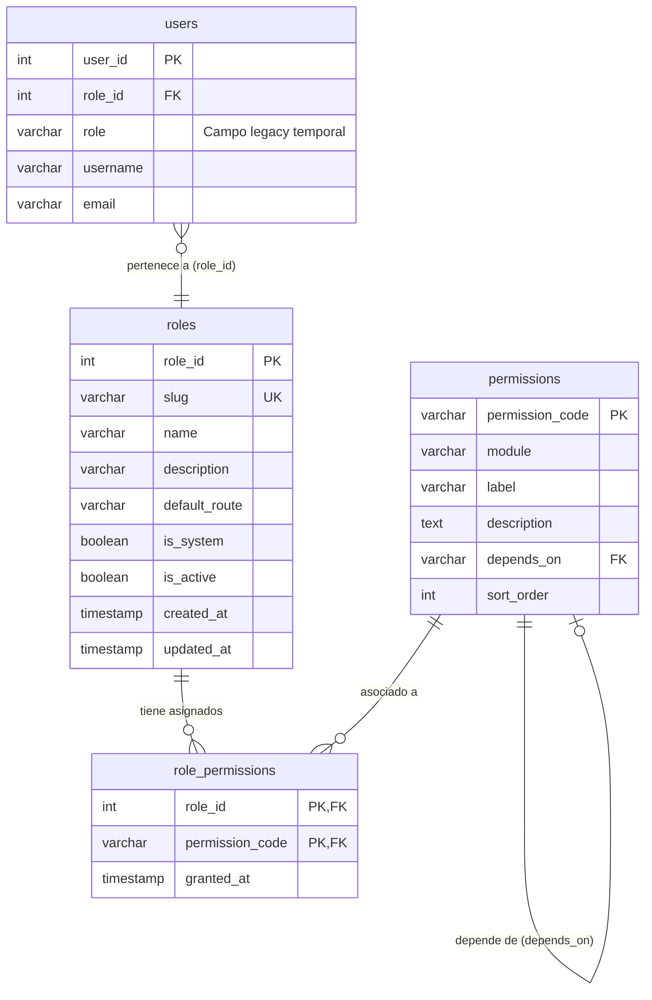

# 🛡️ Propuesta Técnica de Migración: RBAC Dinámico Basado en Permisos (PBAC)

> **Documento de Diseño Arquitectónico (RFC / Migration Proposal)**  
> **Proyecto:** Demo E-commerce / Profarmed / Profarmed (`profarmed_api`)  
> **Estado:** Propuesta / En revisión previa  
> **Objetivo:** Transicionar de un modelo estático de 4 roles (`admin`, `marketing`, `seller`, `warehouse`) a un sistema modular donde el administrador pueda crear roles a medida con asignación granular de políticas y permisos, desacoplando rutas y vistas tanto en Backend (FastAPI) como en Frontend (React).

---

## 1. Motivación y Problema Actual

Actualmente, el control de acceso en el sistema está fuertemente acoplado mediante cadenas de texto rígidas:
- **En Backend:** Endpoints protegidos mediante dependencias aisladas como `get_current_admin_user`, `get_current_seller_user` o condicionales `if user.role not in ['admin', 'marketing']`.
- **En Base de Datos:** Restricción check estática: `CHECK (role IN ('admin', 'marketing', 'seller', 'warehouse'))`.
- **En Frontend:** 
  - Redirección tras login basada en diccionario estático `ROLE_ROUTES` en `LoginForm.jsx`.
  - Protección de rutas con arrays quemados (`allowedRoles={['admin', 'seller']}`) en `App.jsx`.
  - Menús en `SidebarDrawer.jsx` llenos de bloques condicionales `user?.role === 'admin'`.

**Consecuencia:** Si el negocio necesita un nuevo rol (ej. *"Auditor de Calidad"*, *"Líder de Ventas"*, *"Facturista"*), se requiere modificar código fuente en múltiples capas del back y del front.

---

## 2. Visión del Nuevo Sistema (Target Architecture)

1. **Roles 100% Dinámicos:** El Administrador puede crear, editar o clonar roles desde su panel.
2. **Rol Admin Inmutable:** El rol de superadministrador se marca como sistema (`is_system = true`) y no puede ser eliminado ni despojado de sus capacidades.
3. **Permisos Granulares y Seriados (Dependencies):** Cada acción en el sistema (ej. `orders.view`, `orders.edit`, `warehouse.audit`) es un permiso. Algunos permisos dependen jerárquicamente de otros (ej. *para editar pedidos, obligatoriamente requieres ver pedidos*).
4. **Backend Modular:** Una única fábrica de dependencias en FastAPI: `require_permission("orders.edit")` con verificación O(1) vía token JWT o caché.
5. **Frontend Reactivo por Capacidades:** Las vistas, botones de acción y pestañas del menú lateral se renderizan dinámicamente si el usuario posee la capacidad, sin importar cómo se llame su rol.
6. **Zero-Downtime & Cero Roturas:** Compatibilidad total hacia atrás con los roles y flujos actuales durante y después de la migración.

---

## 3. Modelo de Base de Datos Propuesto



### Script DDL Preliminar

```sql
-- 1. Tabla de Roles Dinámicos
CREATE TABLE IF NOT EXISTS roles (
    role_id SERIAL PRIMARY KEY,
    slug VARCHAR(50) UNIQUE NOT NULL,
    name VARCHAR(100) NOT NULL,
    description TEXT,
    default_route VARCHAR(100) NOT NULL DEFAULT '/panel',
    is_system BOOLEAN NOT NULL DEFAULT FALSE,
    is_active BOOLEAN NOT NULL DEFAULT TRUE,
    created_at TIMESTAMP WITH TIME ZONE DEFAULT NOW(),
    updated_at TIMESTAMP WITH TIME ZONE DEFAULT NOW()
);

-- 2. Catálogo Maestro de Permisos
CREATE TABLE IF NOT EXISTS permissions (
    permission_code VARCHAR(100) PRIMARY KEY,
    module VARCHAR(50) NOT NULL,
    label VARCHAR(150) NOT NULL,
    description TEXT,
    depends_on VARCHAR(100) REFERENCES permissions(permission_code) ON DELETE SET NULL,
    sort_order INTEGER DEFAULT 0
);

-- 3. Tabla Pivote de Permisos por Rol
CREATE TABLE IF NOT EXISTS role_permissions (
    role_id INTEGER NOT NULL REFERENCES roles(role_id) ON DELETE CASCADE,
    permission_code VARCHAR(100) NOT NULL REFERENCES permissions(permission_code) ON DELETE CASCADE,
    granted_at TIMESTAMP WITH TIME ZONE DEFAULT NOW(),
    PRIMARY KEY (role_id, permission_code)
);

-- 4. Modificación Segura en Tabla users
ALTER TABLE users 
ADD COLUMN IF NOT EXISTS role_id INTEGER REFERENCES roles(role_id) ON DELETE RESTRICT;

CREATE INDEX IF NOT EXISTS idx_users_role_id ON users(role_id);
```

---

## 4. Sembrado Inicial (Seed) y Compatibilidad sin Romper Nada

Para que la migración no interrumpa las sesiones activas ni la data de producción, se inicializan los 4 roles existentes con sus permisos predeterminados:

### A. Roles del Sistema
| Role ID | Slug | Nombre | Ruta por Defecto | Inmutable (`is_system`) |
|---|---|---|---|---|
| 1 | `admin` | Administrador General | `/admindash` | `TRUE` |
| 2 | `seller` | Agente de Ventas | `/sellerdash` | `FALSE` |
| 3 | `marketing` | Gerente de Mercadotecnia | `/marketingdash` | `FALSE` |
| 4 | `warehouse` | Operador de Bodega | `/warehousedash` | `FALSE` |

### B. Catálogo Inicial de Permisos (Ejemplo Agrupado por Módulos)
- **Módulo `orders`**:
  - `orders.view` — *Ver listado y detalle de pedidos*
  - `orders.create` — *Crear pedidos para clientes* (requiere `orders.view`)
  - `orders.edit` — *Editar partidas y costos de pedidos* (requiere `orders.view`)
  - `orders.cancel` — *Cancelar pedidos* (requiere `orders.view`)
  - `orders.assign` — *Asignar vendedor a pedidos* (requiere `orders.view`)
- **Módulo `warehouse`**:
  - `warehouse.view` — *Ver cola de surtido de almacén*
  - `warehouse.pick` — *Realizar surtido de primer filtro (Picker)* (requiere `warehouse.view`)
  - `warehouse.check` — *Realizar revisión de segundo filtro (Checker)* (requiere `warehouse.view`)
  - `warehouse.audit` — *Auditoría forense y override administrativo* (requiere `warehouse.view`)
- **Módulo `catalog`**:
  - `catalog.view` — *Ver catálogo y existencias*
  - `catalog.prices` — *Administrar listas de precios y markups*
  - `catalog.discounts` — *Crear y activar descuentos/promociones*
- **Módulo `users`**:
  - `users.manage` — *Crear y editar usuarios internos*
  - `roles.manage` — *Crear roles y modificar matriz de permisos* (exclusivo admin)

### C. Migración de Datos Existentes (Backfill)
```sql
-- Asignar role_id a cada usuario basado en su columna role actual
UPDATE users u
SET role_id = r.role_id
FROM roles r
WHERE u.role = r.slug AND u.role_id IS NULL;
```

---

## 5. Arquitectura en Backend (FastAPI)

### A. Token JWT con Permisos en Memoria (O(1) Verification)
Al iniciar sesión (`/auth/login`), el payload JWT incluye:
```json
{
  "sub": "berna",
  "user_id": 1,
  "role": "admin",
  "default_route": "/admindash",
  "permissions": [
    "orders.view",
    "orders.create",
    "orders.edit",
    "warehouse.audit",
    "roles.manage"
  ]
}
```

### B. Fábrica de Dependencias: `require_permission`
En `backend/profarmed_api/core/permissions.py`:

```python
from fastapi import Depends, HTTPException, status
from backend.profarmed_api.dependencies import get_current_user

def require_permission(required_permission: str):
    """
    Inyector de dependencias que valida permisos de forma instantánea
    sin consultar la base de datos en cada request.
    """
    async def dependency(current_user = Depends(get_current_user)):
        # 1. Superadmin bypass total
        if current_user.get("role") == "admin":
            return current_user

        # 2. Validación de permisos en token o sesión
        user_permissions = current_user.get("permissions", [])
        if required_permission not in user_permissions:
            raise HTTPException(
                status_code=status.HTTP_403_FORBIDDEN,
                detail=f"Acceso denegado: Se requiere el permiso '{required_permission}'"
            )
        return current_user

    return dependency
```

### C. Uso Limpio en Rutas
```python
@router.put("/{order_id}/edit")
def edit_order(
    order_id: int, 
    data: OrderEditRequest, 
    user = Depends(require_permission("orders.edit"))
):
    ...
```

---

## 6. Arquitectura en Frontend (React)

### A. Contexto Global de Permisos (`AuthContext.jsx`)
```javascript
export const AuthProvider = ({ children }) => {
  const [user, setUser] = useState(null);

  const hasPermission = (permissionCode) => {
    if (!user) return false;
    if (user.role === 'admin') return true; // Bypass admin
    return user.permissions?.includes(permissionCode) || false;
  };

  const hasAnyPermission = (permissionList = []) => {
    if (!user) return false;
    if (user.role === 'admin') return true;
    return permissionList.some(p => user.permissions?.includes(p));
  };

  return (
    <AuthContext.Provider value={{ user, isAuthenticated, hasPermission, hasAnyPermission }}>
      {children}
    </AuthContext.Provider>
  );
};
```

### B. Redirección Dinámica en Login (`LoginForm.jsx`)
Elimina la dependencia del diccionario rígido:
```javascript
const user = await login(username, password);
// Si el rol tiene ruta asignada en backend la usa; fallback a products para clientes
const targetRoute = user.default_route || (user.user_type === 'customer' ? '/products' : '/admindash');
navigate(targetRoute);
```

### C. Enrutamiento Protegido (`ProtectedRoute.jsx`)
Soporta tanto roles como permisos para migración progresiva:
```jsx
<Route
  path="/orders/edit/:id"
  element={
    <ProtectedRoute requiredPermission="orders.edit">
      <OrderEditPage />
    </ProtectedRoute>
  }
/>
```

### D. Menú Lateral Dinámico (`SidebarDrawer.jsx`)
Se reemplazan los condicionales gigantes por un mapa de configuración:
```javascript
const MENU_MODULES = [
  {
    title: 'Pedidos',
    requiredPermission: 'orders.view',
    items: [
      { label: 'Historial', route: '/admindash?tab=pedidos', permission: 'orders.view', icon: '📦' },
      { label: 'Crear Pedido', route: '/admindash?action=create', permission: 'orders.create', icon: '➕' }
    ]
  },
  {
    title: 'Almacén',
    requiredPermission: 'warehouse.view',
    items: [
      { label: 'Cola FIFO', route: '/warehousedash?tab=cola', permission: 'warehouse.pick', icon: '🏭' },
      { label: 'Auditoría', route: '/warehousedash?tab=auditoria', permission: 'warehouse.audit', icon: '🔍' }
    ]
  }
];
```

---

## 7. Panel de Administración: Creación y Edición de Roles

Se agregará una nueva vista en el panel de administración:
1. **Configuración de Rol:**
   - Nombre (ej. *"Auditor de Calidad"*).
   - Ruta inicial tras iniciar sesión (ej. `/warehousedash`).
2. **Matriz de Permisos (Checkboxes):**
   - Agrupados por módulo (*Pedidos*, *Almacén*, *Catálogo*, *Usuarios*).
   - **Enlace de dependencias en UI:** Si el usuario activa `"orders.edit"`, la interfaz automáticamente marca y deshabilita `"orders.view"` para garantizar consistencia lógica.

---

## 8. Estrategia de Implementación por Fases

| Fase | Tarea Principal | Impacto / Riesgo |
|---|---|---|
| **Fase 1** | Creación de tablas `roles`, `permissions`, `role_permissions` y script de backfill inicial. | 🟢 Bajo (Tablas nuevas, no afecta queries activas). |
| **Fase 2** | Actualización de `auth.py` para inyectar `permissions` y `default_route` en JWT y respuesta de login. | 🟢 Bajo (Retrocompatible con tokens anteriores). |
| **Fase 3** | Implementación de `require_permission` en endpoints FastAPI por módulos. | 🟡 Medio (Revisión metódica de rutas). |
| **Fase 4** | Adopción en Frontend: `hasPermission` en `AuthContext`, menú dinámico en `SidebarDrawer` y `ProtectedRoute`. | 🟡 Medio (Pruebas de visualización por rol). |
| **Fase 5** | Interfaz UI de "Gestión de Roles y Permisos" en `AdminDashboard`. | 🟢 Bajo (Nueva funcionalidad administrativa). |

---

> 📌 **Conclusión:** Esta propuesta transforma la plataforma en un producto SaaS escalable y flexible, resolviendo el problema de raíz sin poner en riesgo la estabilidad del negocio ni la base de datos actual.
